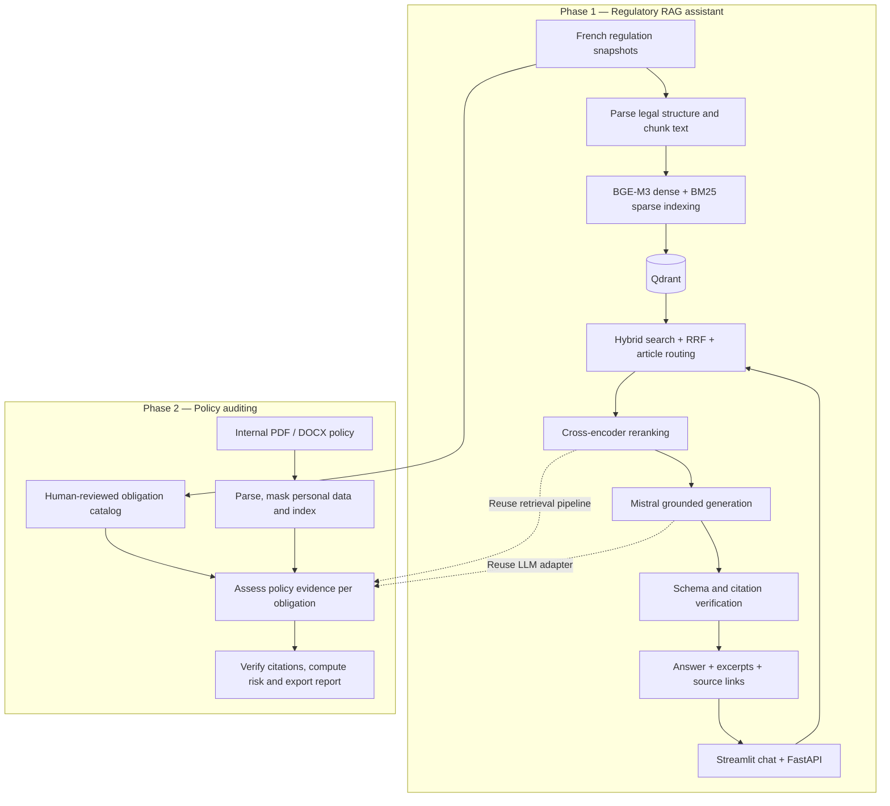

# VeriLegal AI — Hybrid RAG for Regulatory Intelligence

VeriLegal AI aims to help compliance teams **understand EU regulations** and **assess internal
policy coverage** through a hybrid retrieval-augmented generation (RAG) system. The project
combines semantic and lexical retrieval, reranking and LLM generation to produce answers and
audit findings that can be traced to their source passages.

The knowledge base uses the French versions of **RGPD/GDPR**, **DORA** and the **EU AI Act**.
Development follows two phases: a regulatory assistant, then an extension for policy auditing.

> **Current development phase: Phase 1 — Regulatory RAG assistant.**

## Project objectives

### Phase 1 — Regulatory RAG assistant

Deliver a web chat that lets users **ask questions about the regulations in natural language**
and obtain answers grounded in the indexed legal texts.

- **Conversational search:** ask questions, follow up in the same conversation and filter by
  regulation or compare the supported texts.
- **Hybrid retrieval:** combine BGE-M3 semantic embeddings and BM25 lexical search in Qdrant,
  fuse results with Reciprocal Rank Fusion (RRF), then rerank candidate passages with a
  cross-encoder. Route explicit article references directly to the relevant source text.
- **Grounded generation:** use a Mistral LLM to generate structured answers from the retrieved
  evidence, including article references, quoted excerpts and source links.
- **Evidence inspection:** validate response schemas, check citation identifiers and quotations
  against the source chunks, and display verification results. Explain when the corpus does
  not contain sufficient evidence to answer.

The final deliverable is a **Streamlit chat interface backed by a FastAPI service**, connecting
regulation ingestion and indexing to answers with inspectable citations.

Example questions:

- *Que prévoit l'article 32 du RGPD sur la sécurité des données personnelles ?*
- *Quelles sont les exigences de DORA concernant les prestataires de services TIC ?*
- *Quelles obligations de transparence l'article 50 de l'AI Act prévoit-il ?*

### Phase 2 — Policy auditing and gap analysis

Extend the assistant to **compare internal company policies with a versioned, human-reviewed
catalog of regulatory obligations**. The audit will check each obligation against policy
evidence, including requirements that the policy does not address.

- **Policy ingestion:** parse PDF and DOCX documents while preserving sections and tables;
  mask personal information before embedding or external LLM calls.
- **Obligation-driven assessment:** retrieve policy passages for each requirement and assess
  whether it is covered, partially covered, missing or not applicable.
- **Traceable findings:** connect policy excerpts to the corresponding regulatory articles,
  verify quotations and propose actions for identified gaps.
- **Reviewable reports:** present findings and evidence in the web interface, compute overall
  risk using documented rules, and export structured JSON and Markdown reports.

The initial audit scope will cover a reviewed subset of **RGPD and DORA obligations**. An
AI Act obligation catalog is a later extension. Phase 2 will reuse the retrieval, generation,
citation verification and application components delivered in Phase 1.

## Target architecture



Corpus preparation and indexing run before questions are asked. The application, encoders,
retrieval and Qdrant are designed to run locally; **Mistral answer generation uses an external
API** and requires internet access and provider credentials.

## Technical stack

| Layer | Technologies |
|---|---|
| Language and packaging | Python 3.12, uv, installable `src/` package |
| Regulation ingestion | Cellar API, HTTPX, Beautiful Soup, lxml |
| Dense and lexical representations | BGE-M3 via Sentence Transformers, BM25 via FastEmbed |
| Retrieval and reranking | Qdrant, RRF, BGE cross-encoder reranker |
| Generation and validation | Mistral API, Pydantic, RapidFuzz citation checks |
| API, interface and CLI | FastAPI, Streamlit, Typer |
| Policy parsing and masking — Phase 2 | Docling, Microsoft Presidio, spaCy |
| Evaluation and observability | Custom metrics, Ragas, Langfuse, structlog |
| Development checks | pytest, Ruff, mypy, GitHub Actions |

## Development setup

The commands below cover corpus preparation, encoder examples and validation during development.

### Requirements

- **Python 3.12** and [uv](https://docs.astral.sh/uv/).
- Internet access for dependencies and model downloads, with several GB of free disk space.
- **Docker Engine and Compose** to run Qdrant.
- Optional: an NVIDIA GPU with a compatible driver. The encoders also support CPU execution.

### Install and configure

From the repository root:

```bash
uv python install 3.12
uv sync --locked --all-extras
```

For the first setup, copy the configuration template to `.env`; keep an existing `.env`:

```bash
cp .env.example .env
```

The default `VERILEGAL_DEVICE=auto` selects CUDA when available and CPU otherwise. Set it to
`cpu` to force CPU execution. Corpus preparation and local encoder examples do not require
an LLM API key. The Mistral integration will use `MISTRAL_API_KEY` from `.env`.

### Prepare the regulation corpus

French XHTML snapshots are included in `data/raw/regulations/`. Parse them into JSONL chunks:

```bash
uv run verilegal ingest regulations
```

This writes `rgpd.fr.jsonl`, `dora.fr.jsonl` and `aiact.fr.jsonl` to `data/processed/`, plus an
ingestion report under `reports/`. Chunks preserve article structure, parent-child links,
source references and text hashes.

To explicitly refresh the source snapshots and regenerate the corpus:

```bash
uv run verilegal fetch
uv run verilegal ingest regulations
```

### Inspect dense and sparse encoding

After ingestion, run the examples to inspect real vectors for regulation passages and a question:

```bash
uv run python tests_components/demo_embeddings.py
uv run python tests_components/demo_sparse.py
```

The first run may download model resources. The examples print dense-vector similarities or
sparse term weights; they demonstrate encoding rather than full retrieval performance.

Run the real-model component tests with:

```bash
uv run pytest tests_components -m integration -s -v
```

Encoder models, batch sizes and BM25 preprocessing are configured in
[`.env.example`](.env.example).

### Start the development vector database

```bash
uv run poe qdrant
uv run pytest tests/integration/test_qdrant.py -v
```

Qdrant exposes REST on `localhost:6333` and gRPC on `localhost:6334`. The integration test
checks connectivity to the service.

## Validation and evaluation

Run the development quality checks:

```bash
uv run poe check
```

This runs formatting, linting, type checking and unit tests. Unit tests use fixtures and fake
model backends without network requests or model downloads.

Validate retrieval benchmark labels against the local regulation snapshots:

```bash
uv run verilegal eval validate-retrieval
```

The development benchmark contains **90 questions**, spanning exact article references,
French paraphrases, English queries and cross-regulation comparisons. It is an AI-assisted
draft requiring human relevance review; validation checks source consistency. See the
[benchmark documentation](eval/README.md) for its schema, scope and annotation rules.

The evaluation plan covers:

| Scope | Measures |
|---|---|
| Phase 1 — Retrieval | Recall@k, MRR, nDCG and latency; dense, BM25, hybrid and reranking ablations |
| Phase 1 — Answers | Citation verification, faithfulness, follow-ups, insufficient-evidence handling, latency and cost |
| Phase 2 — Auditing | Obligation status macro-F1, gap-detection recall and personal-data masking recall |

Evaluation runs will write measured results under `reports/`. Citation verification checks
that quoted evidence exists; answer faithfulness is evaluated separately.

## Data sources and coverage

| Regulation | Subject | Official French text |
|---|---|---|
| **RGPD / GDPR** | Personal data protection | [Regulation (EU) 2016/679](https://eur-lex.europa.eu/legal-content/FR/TXT/?uri=CELEX:32016R0679) |
| **DORA** | Digital operational resilience in the financial sector | [Regulation (EU) 2022/2554](https://eur-lex.europa.eu/legal-content/FR/TXT/?uri=CELEX:32022R2554) |
| **EU AI Act** | Regulation of artificial intelligence | [Regulation (EU) 2024/1689](https://eur-lex.europa.eu/legal-content/FR/TXT/?uri=CELEX:32024R1689) |

Texts are downloaded as XHTML from the Publications Office of the EU's
[Cellar repository](https://op.europa.eu/en/web/cellar). Snapshot provenance, download dates
and hashes are stored in `data/raw/regulations/manifest.fr.json`.

Coverage is limited to the indexed article and recital content of these snapshots. Source
updates are explicit; the initial corpus does not include AI Act annexes or automatically
track consolidated legislation.

VeriLegal AI is intended as **decision support for compliance teams**, with evidence available
for human review. It does not provide legal advice or certify regulatory compliance.

## Repository guide

| Path | Contents |
|---|---|
| [`src/verilegal/`](src/verilegal/) | Application package: configuration, domain models, ingestion, encoders and evaluation tooling |
| [`data/raw/regulations/`](data/raw/regulations/) | Regulation snapshots and provenance manifest |
| `data/processed/` | Generated JSONL corpus |
| [`eval/`](eval/) | Development benchmark and annotation documentation |
| [`tests/`](tests/) | Unit and integration tests |
| [`tests_components/`](tests_components/) | Real-model demonstrations and component tests |
| [`docker/`](docker/) | Qdrant Compose configuration |
| [`reports/`](reports/) | Ingestion reports and evaluation outputs |
